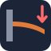
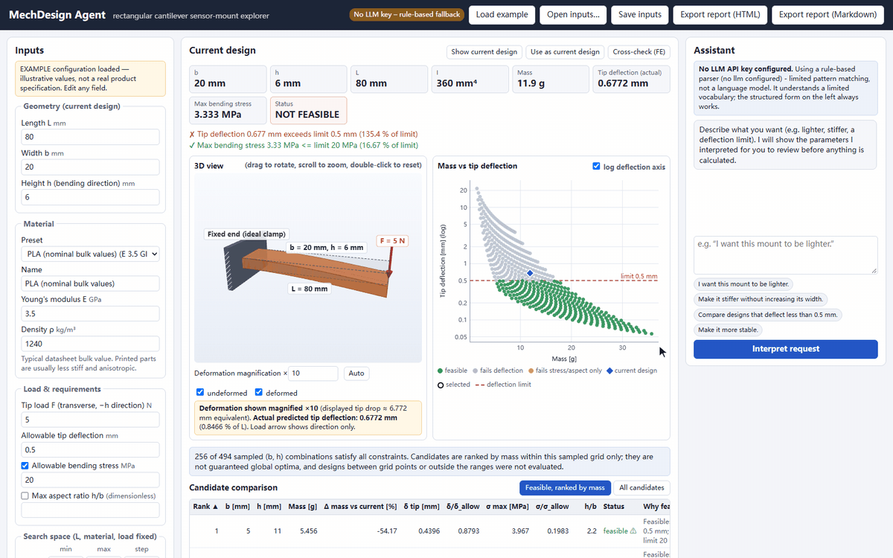
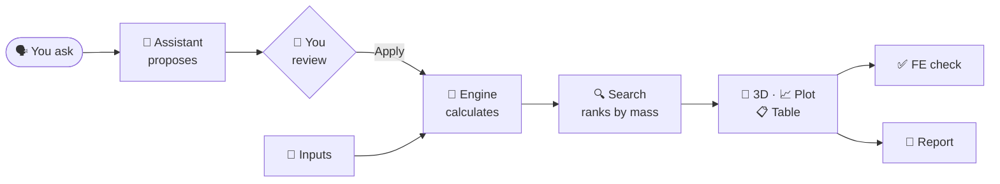
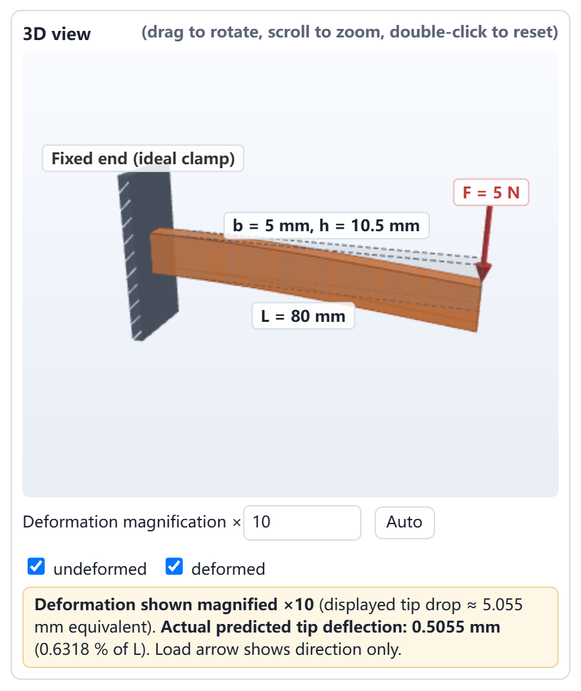
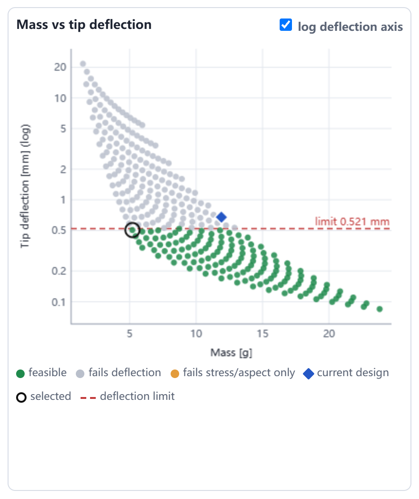
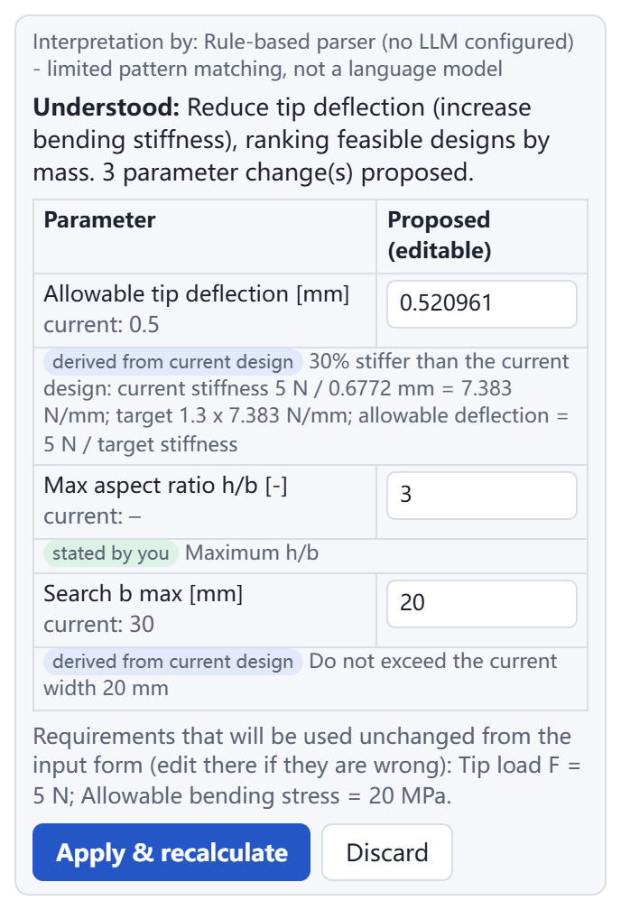
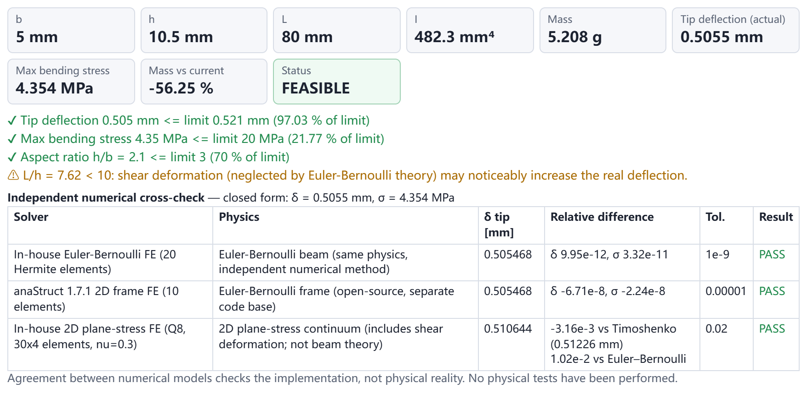
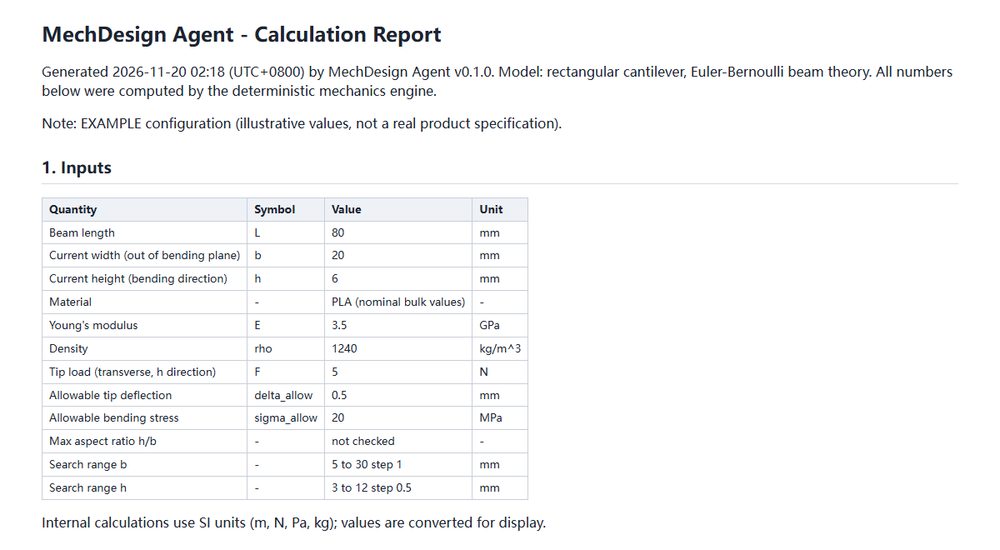
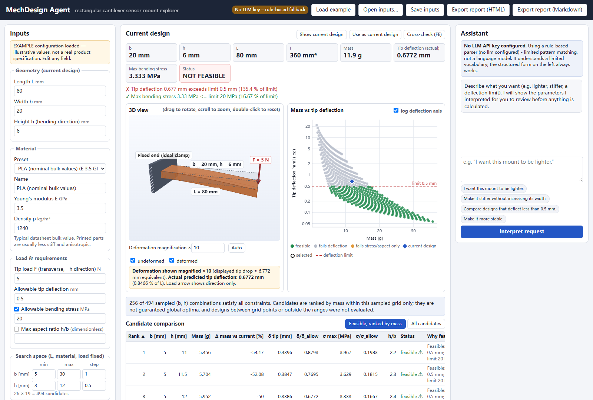

<div align="center">



# MechDesign Agent

### Tell it what your sensor mount needs. It finds the lightest beam that delivers.

Describe a goal in plain English, review the agent's proposal, and explore hundreds of cross-sections ranked by
mass, in an interactive 3D workspace powered by a deterministic mechanics engine and independent finite-element
cross-checks.

<p>


<br>


<a href="LICENSE"></a>
</p>

[**Quick start**](#-quick-start) · [**Features**](#-features) · [**How it works**](#-how-it-works) · [**Gallery**](#-gallery) · [**Docs**](docs/README.md)

<br>



<sub><i>Ask → review → apply → pick the lightest design → spin it in 3D → cross-check it. Recorded from the real app.</i></sub>

</div>

<br>

## ✨ Features

<table>
<tr>
<td width="33%" valign="top">

#### 💬 Plain-English requests

*"Make it 30 % stiffer without increasing its width."* The agent turns requests into concrete parameter changes
and tags every value with its source: **stated by you**, **derived from the current design**, or a
**suggestion** to confirm.

</td>
<td width="33%" valign="top">

#### 🔍 Design-space search

Sweeps every width × height in your ranges, checks the deflection, stress and aspect-ratio limits, and ranks the
passing designs by mass, each with a one-line reason.

</td>
<td width="33%" valign="top">

#### 🧊 Interactive 3D

Rotate and zoom the beam with its clamp, load arrow and deformed shape. The deformation is magnified so you can see
it, and the actual predicted deflection in mm sits right beside it.

</td>
</tr>
<tr>
<td valign="top">

#### 📈 Linked plot and table

A mass-vs-deflection map of every candidate. Click a point or a table row and the numbers, checks and 3D view
follow.

</td>
<td valign="top">

#### ✅ Independent FE cross-checks

Verify any design against three separate solvers: an in-house Hermite beam FE, the open-source
[anaStruct](https://github.com/ritchie46/anaStruct) frame solver and a 2D plane-stress continuum model.

</td>
<td valign="top">

#### 📄 Reports, CLI and API

Export a complete calculation report (HTML or Markdown), script runs with the `mechdesign` command line, or drive
everything through the JSON API.

</td>
</tr>
</table>

## 🧭 How it works



The assistant proposes; the engine calculates. Every calculated number, on screen, in the explanations and in the
reports, comes from the deterministic mechanics engine:

| Quantity | Formula |
|---|---|
| Second moment of area | I = b h³ / 12 |
| Mass | m = ρ b h L |
| Tip deflection | δ = F L³ / (3 E I) |
| Maximum bending stress | σ = 6 F L / (b h²) |

## 📸 Gallery

<table>
<tr>
<td width="50%" valign="top">

<p align="center"><b>3D view</b> · clamp, load and magnified deflection</p>
</td>
<td width="50%" valign="top">

<p align="center"><b>Design map</b> · every candidate, feasible ones in green</p>
</td>
</tr>
<tr>
<td valign="top">

<p align="center"><b>Assistant proposal</b> · review before anything runs</p>
</td>
<td valign="top">

<p align="center"><b>FE cross-check</b> · three independent solvers</p>

<p align="center"><b>Calculation report</b> · HTML or Markdown</p>
</td>
</tr>
</table>

<details>
<summary><b>The full workspace</b></summary>
<br>

</details>

## 💬 Talk to it

| You type | The agent |
|---|---|
| *I want this mount to be lighter.* | Ranks every design that meets your current limits by mass. |
| *Make it 30 % stiffer without increasing its width, and keep h/b at most 3.* | Derives the new deflection limit from the current stiffness, caps the width and adds the aspect-ratio limit. |
| *Compare designs that deflect less than 0.5 mm.* | Sets the deflection limit and compares every design that meets it. |
| *length 12 cm, load 0.01 kN, deflection under 0.2 mm* | Converts the units: L = 120 mm, F = 10 N, δ ≤ 0.2 mm. |
| *Make it more stable.* | Asks what "stable" means for you, plus the load and the acceptable deflection. |

With an Anthropic API key the assistant uses an LLM; without one, a built-in rule-based parser handles requests like
these. More in [examples/example_requests.md](examples/example_requests.md).

## 🚀 Quick start

You need **Python 3.10 or newer** (3.12 or 3.13 recommended). Get the code (**Code → Download ZIP**, or
`git clone <repository-url>`), then:

| Windows | macOS / Linux |
|:---:|:---:|
| Double-click **`start.bat`** | `python3 start.py` |

The first launch sets up a private environment in `.venv` (a few minutes). After that the app opens in seconds at
**<http://127.0.0.1:8000>**, with an example design already calculated.

💡 On Windows, use a short folder path such as `C:\code\mechdesign-agent`.

<details>
<summary><b>Other ways to install</b>: pip, wheel, Docker</summary>

**pip (editable)**

```bash
python -m venv .venv
```

```bash
.venv/Scripts/python -m pip install -e ".[llm,validation]"
```

```bash
.venv/Scripts/mechdesign serve --open
```

On macOS/Linux use `.venv/bin/` instead of `.venv/Scripts/`.

**Wheel**

```bash
pip install "mechdesign_agent-0.1.0-py3-none-any.whl[llm,validation]"
```

```bash
mechdesign serve --open
```

**Docker**

```bash
docker build -t mechdesign-agent .
```

```bash
docker run --rm -p 8000:8000 mechdesign-agent
```

Add `-e ANTHROPIC_API_KEY=...` to the run command to enable the LLM. The image leaves out the optional anaStruct
solver (see [THIRD_PARTY_NOTICES.md](THIRD_PARTY_NOTICES.md)).

</details>

<details>
<summary><b>Enable the LLM assistant</b></summary>

Copy [`.env.example`](.env.example) to `.env` and set your key, or set the variables in your environment. The key is
read by the Python server only.

| Variable | Default | Purpose |
|---|---|---|
| `ANTHROPIC_API_KEY` | – | Enables LLM interpretation and explanations |
| `MECHDESIGN_LLM_MODEL` | `claude-opus-5-5` | Model id |
| `MECHDESIGN_DISABLE_LLM` | – | Set to `1` to use the rule-based parser |
| `MECHDESIGN_HOST` / `MECHDESIGN_PORT` | `127.0.0.1` / `8000` | Bind address |

</details>

## 💻 Command line

Everything in the web app is also scriptable:

```console
$ mechdesign run examples/example_config.json --top 3
MechDesign Agent 0.1.0 - rectangular cantilever, Euler-Bernoulli beam theory
L = 80 mm, material PLA (nominal bulk values) (E = 3.5 GPa), F = 5 N, allowable deflection 0.5 mm, allowable stress 20 MPa

Current design b = 20 mm, h = 6 mm: mass 11.9 g, tip deflection 0.6772 mm, max stress 3.333 MPa -> NOT FEASIBLE
  [FAIL] Tip deflection 0.677 mm exceeds limit 0.5 mm
  [pass] Max bending stress 3.33 MPa <= limit 20 MPa

Feasible candidates ranked by mass:
rank   b [mm]   h [mm]  mass [g]   vs cur  defl [mm] stress [MPa]  id
---------------------------------------------------------------------
   1        5       11     5.456   -54.2%     0.4396        3.967  b5_h11
   2        5     11.5     5.704   -52.1%     0.3847        3.629  b5_h11.5
   3        5       12     5.952   -50.0%     0.3386        3.333  b5_h12
```

| Command | What it does |
|---|---|
| `mechdesign serve --open` | Start the web app |
| `mechdesign example -o mount.json` | Write the example configuration to edit |
| `mechdesign run mount.json --top 5` | Rank the candidates (`--json` for machine-readable output) |
| `mechdesign report mount.json --select b6_h10 -o report.html` | Write a calculation report |
| `mechdesign validate` | Run the FE cross-check suite |

## 🧪 Verified

| Independent solver | Physics | Pass tolerance |
|---|---|---|
| In-house Hermite beam FE | Euler–Bernoulli, separate numerical method | 1e-9 |
| [anaStruct](https://github.com/ritchie46/anaStruct) | Open-source 2D frame FE | 1e-5 |
| In-house Q8 plane-stress FE | 2D continuum, including shear | 2 % vs Timoshenko |

**106** automated tests · **36/36** documented cross-checks · CI on Linux, Windows and macOS.
See the [validation report](docs/validation.md) and [test results](docs/test-results.md).

## 📚 Documentation

| Guide | What's inside |
|---|---|
| [User guide](docs/user-guide.md) | The web workflow, the assistant, reports, the CLI and the configuration format |
| [Model](docs/model.md) | Equations, sign conventions, units and validity warnings |
| [Validation](docs/validation.md) | Solvers, test cases, tolerances and results |
| [Architecture](docs/architecture.md) | Modules and design decisions |
| [HTTP API](docs/api.md) | JSON endpoints (interactive at `/docs` while the server runs) |
| [Examples](examples/) | Configurations, example requests and sample reports |

## 🔧 Development

```bash
pip install -e ".[dev]"
```

```bash
pytest --cov
```

```bash
ruff check . && ruff format --check . && mypy
```

```bash
python -m build
```

The last command writes the wheel and source package to `dist/`. See [CONTRIBUTING.md](CONTRIBUTING.md) to get
involved.

<details>
<summary><b>Project layout</b></summary>

```
start.py, start.bat one-step launcher: creates .venv, installs, opens the app
src/mechdesign/
  mechanics.py      deterministic engine: formulas, validation, feasibility, grid search
  units.py          display units <-> SI
  fem.py            independent solvers: Hermite beam FE, anaStruct wrapper, Q8 plane-stress FE
  crosscheck.py     compare one design against the solvers
  validation.py     the documented cross-check suite
  report.py         HTML / Markdown calculation report
  language/         interpretation + explanations: schema, rule_parser, llm, service
  server.py         FastAPI HTTP layer;  cli.py  command line
  web/              front end (plain ES modules, canvas plot, Three.js 3D view)
tests/              pytest suite        examples/   configs, requests, sample reports
docs/               documentation       validation/ generated cross-check results
scripts/            screenshot and demo recorders for the docs
```

</details>

## 📄 License

[MIT](LICENSE). Third-party components are listed in [THIRD_PARTY_NOTICES.md](THIRD_PARTY_NOTICES.md).

<div align="center">
<br>
<sub>Built with FastAPI · NumPy · SciPy · Three.js</sub>
</div>
